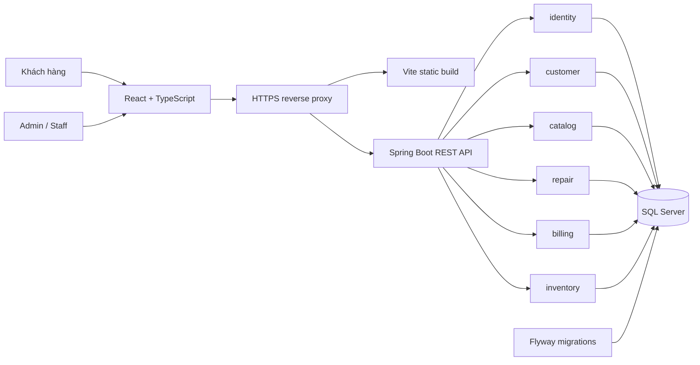

# Kiến trúc hệ thống Garage MVP

Ngày cập nhật: 17/11/2026. Tài liệu mô tả kiến trúc đích; source hiện có scaffold Maven/Vite, migration nền 11 bảng và identity MVP. Các use case garage còn lại chưa triển khai.

Tham chiếu: [đặc tả nghiệp vụ](requirements.md), [ERD SQL Server](erd.md).

## 1. Quyết định kiến trúc

| Nội dung | Quyết định |
|---|---|
| Backend | Java 21, Spring Boot 3.5.16, Maven; một ứng dụng modular monolith |
| Module | identity, customer, catalog, repair, billing, inventory |
| Database | Một SQL Server 2022+, schema dbo; Flyway là nguồn quản lý schema |
| Frontend | React + TypeScript + Vite, tổ chức theo feature |
| Đăng nhập | Chỉ Admin/Staff, session cookie phía server |
| Khách | Guest booking và lookup public, không tạo tài khoản ngầm |
| Deploy | Một backend instance, frontend và API cùng origin qua reverse proxy |
| Chưa dùng | Microservices, Redis, message broker, CQRS, event sourcing |



Một Maven artifact chứa sáu package nghiệp vụ, không phải sáu service hoặc sáu Maven project. Booking và slot thuộc repair để giữ đúng cấu trúc yêu cầu mà không thêm module scheduling.

## 2. Ranh giới module và các lớp

| Module | Sở hữu nghiệp vụ/dữ liệu |
|---|---|
| identity | User Admin/Staff, đăng nhập, session, phân quyền |
| customer | Customer, vehicle, chuẩn hóa liên hệ và nhận diện xe |
| catalog | Service và giá dịch vụ tham khảo |
| repair | Cấu hình giờ làm, slot, booking, check-in, repair order/items; điều phối hoàn tất sửa |
| billing | Invoice, số tiền chốt, trạng thái thanh toán và sửa nhầm ghi nhận |
| inventory | Part, tồn hiện tại, ledger nhập/xuất/hoàn/điều chỉnh |

Mỗi module dùng cùng một hướng phụ thuộc:

```text
api -> application -> domain
infrastructure -> domain
```

- **api**: HTTP controller, DTO, validation hình dạng, ánh xạ lỗi và principal. Không chứa transaction nghiệp vụ hoặc trả JPA entity.
- **application**: use case, quyền tác nghiệp, transaction, orchestration, interface công khai cho module khác.
- **domain**: mô hình, chuyển trạng thái, tính tiền và repository port; không import Spring, HTTP hoặc JPA.
- **infrastructure**: JPA entity/repository adapter, truy vấn T-SQL cần khóa, cấu hình Security và tích hợp kỹ thuật. Spring wiring đặt ở đây.

repair có thể gọi application interface của customer, catalog, inventory và billing. Các module được gọi không gọi ngược vào repair. FK trong cùng database không đồng nghĩa cho phép import repository của module khác.

Ví dụ repair khóa phiếu, tạo dòng phụ tùng và gọi inventory để ghi xuất dùng trong cùng transaction. Inventory nhận ID/thông tin tham chiếu đã được repair kiểm tra, không tự gọi repository phiếu sửa. Billing nhận tổng đã tính từ repair khi hoàn tất; không tự sửa dòng công việc.

Audit và idempotency là hỗ trợ kỹ thuật dùng chung, không phải module nghiệp vụ thứ bảy. Khi triển khai có thể đặt adapter dùng chung trong package hỗ trợ nhỏ; không đưa nghiệp vụ garage vào package đó.

## 3. Luồng chính và transaction

### 3.1 Guest booking

```mermaid
sequenceDiagram
    actor Guest as Khách
    participant API as repair.api
    participant App as repair.application
    participant Customer as customer.application
    participant DB as SQL Server
    Guest->>API: POST booking + Idempotency-Key
    API->>App: Validated command
    App->>DB: BEGIN; khóa idempotency key
    App->>DB: Khóa slot; kiểm tra giờ/trùng biển số/capacity
    App->>Customer: Tìm hoặc tạo customer và vehicle
    Customer->>DB: Đọc/ghi trong cùng transaction
    App->>DB: Kiểm tra dịch vụ; lưu booking + snapshots
    App->>DB: Lưu kết quả idempotency; COMMIT
    App-->>Guest: 201 + bookingCode + thời gian
```

Transaction boundary nằm ở application service ngoài cùng, các service nội bộ tham gia cùng transaction bằng propagation mặc định `REQUIRED`. Không dùng `REQUIRES_NEW` cho tạo customer/xe vì lỗi booking phải rollback toàn bộ.

Các quy tắc cạnh tranh trên SQL Server:

- Khóa slot cụ thể bằng truy vấn `WITH (UPDLOCK, HOLDLOCK)` trong transaction trước khi đếm booking; mọi đường tạo, đổi và hủy booking phải tuân thủ cùng cơ chế.
- Tìm/tạo customer bằng điều kiện equality trên unique index `customers.phone_normalized`, dùng `WITH (UPDLOCK, HOLDLOCK)` trước INSERT. Khóa được giữ đến hết transaction; không dựa vào thao tác “find rồi save” không khóa.
- Dưới khóa slot, so khớp `plate_normalized_snapshot` trong các booking `CONFIRMED`, `CHECKED_IN`, `COMPLETED`, trước khi tạo hồ sơ mới hoặc kiểm tra capacity. Filtered unique index trong [ERD](erd.md) bảo vệ thêm ở DB; xung đột trả `409 BOOKING_CONFLICT` và không tiết lộ booking cũ. Đổi lịch cũng kiểm tra trùng ở slot đích.
- Đổi lịch khóa slot cũ/mới theo ID tăng dần. Khóa các slot trước, sau đó khóa booking và đọc lại trạng thái/version; nếu booking đã đổi bởi request khác thì trả `409` và tải lại.
- Không dùng `NOLOCK` cho tính sức chứa, số dư kho hoặc thanh toán.
- Deadlock được rollback toàn bộ; retry tối đa hai lần cho lỗi deadlock, giữ nguyên idempotency key. Không retry mù lỗi dữ liệu hoặc lỗi nghiệp vụ.

`UPDLOCK` và `HOLDLOCK` là cú pháp SQL Server; không dùng `SELECT FOR UPDATE`. Tham chiếu chính thức: [Microsoft — Table hints](https://learn.microsoft.com/en-us/sql/t-sql/queries/hints-transact-sql-table).

`HOLDLOCK` tương đương `SERIALIZABLE` ở phạm vi bảng được truy vấn, nên đổi tên hint này không sửa một lỗi cạnh tranh khác. Với phép tìm khóa chưa tồn tại qua index phù hợp, tổ hợp `UPDLOCK, HOLDLOCK` dùng update-range lock thay vì chỉ shared-range lock. Đây là thiết kế cần kiểm thử đồng thời trên SQL Server, không phải bảo đảm mọi transaction sẽ hết deadlock. Không thay bằng MERGE hoặc tăng mức khóa khi chưa có bằng chứng cần thiết.

Nếu unique constraint vẫn báo xung đột, rollback transaction ngoài cùng rồi đọc/xử lý lại trong transaction mới phù hợp; không bắt lỗi INSERT rồi tiếp tục dùng transaction JPA đã bị đánh dấu rollback-only.

### 3.2 Sinh slot và đổi cấu hình

- Đối soát slot từ ngày hiện tại đến hết ngày `today + maximum_advance_days` khi khởi động, mỗi ngày lúc 00:05 theo `Asia/Ho_Chi_Minh`, trong transaction thay đổi cấu hình/ngày nghỉ và khi Admin yêu cầu sinh bù. Chạy lại với cùng dữ liệu không tạo trùng hoặc tăng version của slot không đổi.
- `GET /public/slots` chỉ SELECT trong transaction read-only; không INSERT, không lấy update lock trên garage_settings. Spring readOnly là khai báo ý định, không thay cho kiểm tra code/query để bảo đảm đường đọc không ghi.
- Sinh slot và sửa cấu hình khóa cùng hàng garage_settings rồi khóa các slot liên quan theo thứ tự ID. Cập nhật `generated_through` cùng transaction để đánh dấu đã xử lý đủ cả ngày nghỉ không có slot.
- Chỉ thay/tạo lại slot tương lai chưa có booking hoặc điều chỉnh riêng. Giữ ID, khung giờ và sức chứa của slot có booking khi đổi mẫu lịch. Slot được giữ nhưng không còn hợp cấu hình mới phải đóng nhận thêm, vẫn cho check-in lịch cũ. Slot mới cùng loại xe không được giao với slot giữ lại.
- `manual_closed` lưu quyết định đóng của Admin. `capacity_override` lưu sức chứa riêng, kể cả 0. Bỏ ngày nghỉ không mở lại slot bị đóng riêng. Khi xóa override cuối cùng, slot không có booking và nằm ngoài mẫu mới có thể bị xóa.
- Đóng slot/ngày nghỉ ngăn đặt thêm nhưng không hủy các lịch tồn tại. Check-in lịch đã xác nhận vẫn được phép.
- Startup chỉ sẵn sàng phục vụ booking sau khi sinh slot thành công. Nếu job thất bại, giữ dữ liệu đã commit và ghi lỗi vận hành; ngày vượt `generated_through` trả `503 SLOT_SCHEDULE_UNAVAILABLE`. Ngày đã sinh nhưng đóng cửa trả danh sách rỗng. Không sinh bù trong GET.
- UI availability chỉ là gợi ý tại thời điểm đọc; server luôn kiểm tra lại khi đặt.

### 3.3 Xuất và hoàn phụ tùng

```mermaid
sequenceDiagram
    actor Staff as Staff
    participant Repair as repair.application
    participant Stock as inventory.application
    participant DB as SQL Server
    Staff->>Repair: Xác nhận sử dụng phụ tùng + request key
    Repair->>DB: BEGIN; khóa key và phiếu sửa
    Repair->>DB: Kiểm tra IN_PROGRESS; tìm/tạo dòng PART theo part_id
    Repair->>Stock: Xuất part cho repair item
    Stock->>DB: Khóa part; kiểm tra tồn; cập nhật stock
    Stock->>DB: INSERT stock_movement ISSUE
    Repair->>DB: Cập nhật net quantity; audit; COMMIT
    Repair-->>Staff: Tồn và chi phí mới
```

Khóa theo thứ tự: idempotency → phiếu sửa → các part theo ID tăng dần → movement gốc khi hoàn. Mọi thao tác xuất/hoàn phải khóa phiếu trước để không chạy cùng lúc với hoàn tất sửa. Giao dịch nhập/điều chỉnh độc lập chỉ cần khóa part.

Khi hoàn, kiểm tra lượng ISSUE còn được hoàn dưới khóa part, ghi movement RETURN và giảm quantity của dòng PART. Không sửa ledger gốc và không nhận con số tồn cuối từ frontend.

Mỗi `(repair_order_id, part_id)` có tối đa một dòng PART, được bảo vệ bằng filtered unique index. ISSUE lần sau dùng lại repair_item_id, giữ unit_price đã chụp ở lần đầu và cộng quantity. RETURN giảm quantity theo ISSUE gốc; quantity về 0 vẫn giữ dòng. PATCH price chỉ khi IN_PROGRESS, có reason/audit và áp dụng cho toàn bộ quantity ròng của dòng, không tạo bảng giá theo lần xuất.

Khóa hàng part là cần thiết vì tồn của một phụ tùng được dùng chung toàn garage; không chủ động khóa toàn bảng hoặc toàn kho. Giao dịch trên các phụ tùng/phiếu độc lập không cần cùng một application lock. SQL Server vẫn có thể lấy khóa rộng hơn do kế hoạch truy vấn hoặc lock escalation, vì vậy giữ transaction ngắn và kiểm tra index thực tế.

### 3.4 Hoàn tất sửa và thu tiền

1. Đọc booking_id bất biến của phiếu, rồi trong transaction khóa booking trước, khóa repair order sau; kiểm tra lại liên kết, trạng thái/version và net quantity từ các thao tác kho đã commit.
2. Tính từng dòng bằng BigDecimal, `setScale(0, RoundingMode.HALF_UP)`, rồi cộng tổng; không lấy tổng do client gửi. Nếu đối chiếu SQL, dùng DECIMAL và `ROUND(quantity * unit_price, 0)`.
3. Khóa dữ liệu liên quan và cập nhật phiếu/booking `COMPLETED`.
4. Gọi billing tạo hóa đơn `UNPAID`, lưu tổng cố định; commit toàn bộ hoặc rollback toàn bộ.
5. Thu tiền là request riêng: khóa invoice, kiểm tra `UNPAID`, lưu thông tin thu đủ và audit trong một transaction.

Hoàn tất đi theo thứ tự booking → repair order → invoice, không khóa slot vì trạng thái CHECKED_IN và COMPLETED đều tính giữ lượt. Check-in online đi theo thứ tự slot → booking → tạo/đọc repair order ở IN_PROGRESS; walk-in tạo booking CHECKED_IN và repair order IN_PROGRESS trong cùng transaction. Nếu check-in lặp gặp phiếu đã hoàn tất thì trả trạng thái hiện tại, không chuyển lùi.

Không đảo thành repair order → booking khi hoàn tất: request check-in lặp có thể đang giữ booking rồi chờ đọc repair order, tạo vòng chờ với request hoàn tất. Các lệnh LABOR/PART chỉ cần khóa repair order và không lấy khóa booking sau đó. Chỉ sửa LABOR, giá PART và xuất/hoàn ở IN_PROGRESS. Không có use case start; không gọi hoàn tất trên phiếu chưa được tạo/commit.

Unique booking_id của repair_orders và unique repair_order_id của invoices ngăn tạo lặp. Request hoàn tất lặp trả lại hóa đơn đã có; không tạo hóa đơn mới hoặc trừ kho lần nữa.

### 3.5 Idempotency

- Bắt buộc header `Idempotency-Key` cho tạo booking, walk-in, xuất/hoàn, nhập/điều chỉnh kho và ghi nhận/sửa nhầm thanh toán.
- Client sinh UUID cho một thao tác; giữ nguyên khi retry do timeout, chỉ sinh khóa mới cho ý định mới.
- Server chuẩn hóa nội dung, tính SHA-256, đọc equality `(scope, request_key)` qua composite PK với `WITH (UPDLOCK, HOLDLOCK)` trong transaction trước thao tác nghiệp vụ.
- Hai request cùng key: request thứ hai chờ khóa của request đầu. Sau commit, nó đọc lại kết quả để replay hoặc kiểm tra khác hash. Nếu request đầu rollback, request thứ hai không thấy bản ghi và được thực hiện use case. Không có pending record được commit riêng.
- Cùng key/cùng hash trả kết quả đã commit; khác hash trả `409 IDEMPOTENCY_CONFLICT`.
- Kết quả và dữ liệu nghiệp vụ commit cùng nhau. Request lỗi rollback không giữ một kết quả thành công giả.
- Hoàn tất/check-in ngoài idempotency còn được bảo vệ bằng trạng thái và unique constraint.
- Giới hạn chờ khóa 5 giây; hết hạn trả `503 REQUEST_IN_PROGRESS` với Retry-After và yêu cầu retry cùng key. Chỉ retry toàn transaction cho deadlock như mục 3.1, không biến timeout thành thao tác mới.

## 4. Hợp đồng API dự kiến

Prefix `/api`. JSON UTF-8. Tên JSON dùng camelCase; tên cột DB dùng snake_case. ID BIGINT trả dưới dạng chuỗi JSON để tránh mất độ chính xác JavaScript; thời gian dùng ISO 8601 có offset. Tiền là số nguyên VND trong giới hạn số nguyên an toàn của JavaScript; backend từ chối giá trị/tổng vượt `9007199254740991`. Số lượng tối đa ba chữ số thập phân.

### 4.1 Public

| Method và path | Input chính | Output |
|---|---|---|
| `GET /public/services` | vehicleType | Dịch vụ đang hoạt động, giá tham khảo |
| `GET /public/slots` | date `YYYY-MM-DD`, vehicleType | Slot, giờ và remainingCapacity |
| `POST /public/bookings` | Liên hệ, xe, serviceIds, slotId; request key | Mã booking, trạng thái, thời gian, dịch vụ |
| `POST /public/lookups` | Đúng một trong phone/bookingCode; page, size | Page DTO public; tra mã trả tối đa một phần tử |

Ví dụ tạo booking:

```json
{
  "contact": { "fullName": "Nguyễn Văn An", "phone": "0912345678" },
  "vehicle": { "type": "CAR", "plateNumber": "30A-123.45" },
  "serviceIds": ["1", "3"],
  "slotId": "101",
  "note": "Kiểm tra tiếng kêu khi phanh"
}
```

Response `201` không trả customer ID, vehicle ID hoặc hồ sơ khách đã có. Tra cứu phone/code dùng POST để không đưa thông tin vào URL. Cả hai trường cùng có hoặc cùng thiếu trả `400`.

Lookup response là projection có allowlist, không serialize entity rồi che trên UI. Response có `Cache-Control: no-store`; không log request body. Không có kết quả trả `200` với danh sách rỗng.

### 4.2 Authentication

| Method và path | Hành vi |
|---|---|
| `GET /auth/csrf` | Trả CSRF token trước/sau đăng nhập, tạo session khi cần |
| `POST /auth/login` | Username/password và CSRF token; tạo session sau xác thực |
| `GET /auth/me` | Thông tin tối thiểu của nhân viên hiện tại |
| `POST /auth/logout` | Kiểm tra CSRF, hủy session và cookie |

Chỉ public services/slots/bookings/lookups và cơ chế lấy CSRF/login cần được phép truy cập chưa đăng nhập. Các POST public không dùng quyền session và được loại trừ CSRF theo đúng endpoint; các route nội bộ vẫn bảo vệ CSRF. Đăng nhập thất bại trả lỗi chung, không tiết lộ username tồn tại.

### 4.3 Staff và Admin

| Nhóm | Endpoint dự kiến |
|---|---|
| Khách/xe | `GET/POST /staff/customers`, `PATCH /staff/customers/{id}`, `GET/POST /staff/customers/{id}/vehicles`, `PATCH /staff/vehicles/{id}` |
| Booking | `GET /staff/bookings`, `POST /staff/walk-ins`, `POST /staff/bookings/{id}/reschedule`, `/cancel`, `/no-show`, `/check-in` |
| Phiếu sửa | `GET /staff/repair-orders`, `GET/PATCH /staff/repair-orders/{id}`, `POST /staff/repair-orders/{id}/complete` |
| Công việc | `POST /staff/repair-orders/{id}/labor-items`, `PATCH/DELETE /staff/repair-orders/{id}/labor-items/{itemId}` |
| Phụ tùng trên phiếu | `POST /staff/repair-orders/{id}/part-issues` nhận partId/quantity; `/part-returns` nhận originalIssueId/quantity; `PATCH /staff/repair-orders/{id}/part-items/{itemId}/price` nhận unitPrice/reason trước hoàn tất |
| Kho cho nhân viên | `GET /staff/parts`, `GET /staff/stock-movements` |
| Hóa đơn | `GET /staff/invoices`, `GET /staff/invoices/{id}`, `POST /staff/invoices/{id}/mark-paid` |
| Tài khoản | `GET/POST /admin/users`, `PATCH /admin/users/{id}` cho role, tên, trạng thái và reset mật khẩu |
| Danh mục | `GET/POST /admin/services`, `PATCH /admin/services/{id}`; `GET/POST /admin/parts`, `PATCH /admin/parts/{id}` |
| Nhập/điều chỉnh kho | `POST /admin/stock-receipts`, `POST /admin/stock-adjustments` |
| Sửa nhầm thu tiền | `POST /admin/invoices/{id}/reset-payment`, bắt buộc reason |
| Cấu hình lịch | `GET/PUT /admin/schedule-settings`, `GET/POST /admin/closed-dates`, `DELETE /admin/closed-dates/{id}`, `GET /admin/slots`, `PATCH /admin/slots/{id}`, `POST /admin/schedule/regenerate` |

`PUT /admin/schedule-settings` gửi `expectedVersion`, các thông số lịch và mảng `workingHours` gồm `dayOfWeek`, `opensAt` và `closesAt`. Ngày nghỉ dùng `date` và `reason`. POST thêm ngày nghỉ gửi `expectedSettingsVersion` trong JSON, DELETE nhận version này qua query. GET ngày nghỉ nhận `from` và `through`, đều tính cả ngày biên. GET slot Admin nhận `date` và `vehicleType`. PATCH slot gửi `expectedVersion`, `manualClosed` và `capacityOverride`, với `null` để bỏ sức chứa riêng. Trả `204` nếu thao tác bỏ override khiến slot không còn hợp mẫu và bị xóa.

Các path rút gọn trong một ô giữ nguyên prefix của path đầy đủ cùng hàng. Không hỗ trợ DELETE booking, invoice, movement hoặc danh mục có lịch sử. Thao tác danh mục dùng active=false khi ngừng sử dụng.

Các lệnh PATCH/chuyển trạng thái gửi version hiện tại của đối tượng khi có optimistic locking; xung đột trả `409 STALE_VERSION`. UI tải lại trước khi cho sửa tiếp.

### 4.4 Lỗi và phân trang

```json
{
  "code": "SLOT_FULL",
  "message": "Khung giờ đã hết chỗ. Vui lòng chọn giờ khác.",
  "fieldErrors": [],
  "traceId": "request-correlation-id"
}
```

| HTTP status | Trường hợp |
|---|---|
| 400 | Input không hợp lệ, dịch vụ sai loại xe, query lookup không hợp lệ |
| 401 / 403 | Chưa đăng nhập / không đủ quyền hoặc sai CSRF |
| 404 | Tài nguyên nội bộ không tồn tại |
| 409 | Slot đầy/đóng, tồn không đủ, trạng thái sai, version cũ, idempotency xung đột |
| 429 | Vượt giới hạn request |
| 503 | Lịch chưa được sinh đủ hoặc timeout chờ thao tác cùng key; trả code và Retry-After để client xử lý |
| 500 | Lỗi không dự kiến; không lộ stacktrace hoặc SQL |

Danh sách có `items`, `page` (bắt đầu 0), `size`, `totalElements`, `totalPages`. Mặc định size 20, tối đa 100; sort theo allowlist, mặc định thời điểm mới nhất và ID giảm dần để ổn định thứ tự.

## 5. Frontend và màn hình

| Nhóm người dùng | Màn hình |
|---|---|
| Khách | Danh mục dịch vụ, đặt lịch, kết quả đặt lịch, tra cứu |
| Staff | Đăng nhập, lịch hẹn, tiếp nhận/walk-in, khách/xe, phiếu sửa, phụ tùng/tồn, hóa đơn |
| Admin | Toàn bộ Staff; tài khoản, danh mục, nhập/điều chỉnh kho, cấu hình lịch |

Feature đặt trong `frontend/src/features/{auth,booking,lookup,customer,vehicle,service,repair,part,inventory,invoice,settings}`. Booking và lookup không phụ thuộc route đăng nhập. UI guard chỉ hỗ trợ điều hướng, backend vẫn quyết định quyền.

Màn hình đặt lịch phân biệt giá tham khảo và chi phí thực tế; hiển thị slot theo giờ Việt Nam. Khi backend báo hết chỗ, giữ thông tin form và tải lại availability. Khi gửi timeout, giữ request key cho retry.

Màn hình phiếu sửa phân biệt ghi công việc, xác nhận xuất phụ tùng và hoàn phụ tùng. Không dùng nút “lưu phiếu” để âm thầm xuất kho nhiều lần. Sau hoàn tất khóa chỉnh sửa; hóa đơn hiển thị rõ chưa thu/đã thu đủ.

## 6. Bảo mật và vận hành

- Spring Security kiểm tra role ở API và quyền thao tác trong application. BCrypt cho mật khẩu; không có tài khoản/mật khẩu mặc định trong source.
- Session server-side, timeout không hoạt động 30 phút; đổi session ID khi đăng nhập. Cookie production: HttpOnly, Secure, SameSite=Lax.
- Không giả định HttpSession tự tra cứu được mọi session theo user. MVP dùng `users.auth_version BIGINT DEFAULT 0`; principal trong session lưu userId, role và authVersion khi đăng nhập.
- Khi khóa/mở khóa user, đổi role hoặc reset mật khẩu, cập nhật user và tăng auth_version trong cùng transaction. Một OncePerRequestFilter chạy sau khi nạp SecurityContext, trước AuthorizationFilter: đọc users từ DB cho request `/api/staff/**`, `/api/admin/**`, `/api/auth/me`; nếu inactive, role/version khác hoặc user không còn thì invalidate session hiện tại, clear context/cookie và trả `401 SESSION_REVOKED`.
- Không cache kiểm tra trên trong MVP. Mọi session cũ mất quyền từ request kế tiếp sau commit, kể cả khóa rồi mở khóa lại; không hứa dừng request đã được cấp quyền trước commit. Không cần thêm Spring Session/Redis chỉ để đáp ứng nghiệp vụ này. Nếu DB không kiểm tra được thì từ chối xử lý nội bộ với `503`, không tiếp tục dựa vào role cũ.
- Local dùng Vite proxy `/api`; production cùng origin nên không cần mở CORS `*`.
- Public lookup là quyết định sản phẩm, không phải cơ chế xác thực. Không cho phép sửa dữ liệu bằng số điện thoại/mã tra cứu.
- Giới hạn ban đầu theo IP: đặt lịch 10 request/10 phút; lookup 30 request/phút; đăng nhập thất bại 5 lần/5 phút theo IP + username. Response `429` có Retry-After; cấu hình có thể điều chỉnh.
- Rate limiter in-memory phù hợp một instance; restart làm mất bộ đếm. Chỉ tin forwarded IP từ reverse proxy do hệ thống quản lý.
- Log có traceId, route, status và thời lượng; không log body có liên hệ, cookie, password hoặc token. Audit nghiệp vụ lưu riêng, chỉ quyền quản trị được xem.
- Lấy credentials từ biến môi trường. Chứng thư SQL Server được kiểm tra khi deploy; trustServerCertificate=true chỉ dùng local.
- Backup database hàng ngày, bảo vệ file backup và thử restore định kỳ; không chạy Flyway clean trên database dùng thật.

## 7. Migration, kiểm thử và triển khai

### Migration

- Script đặt tập trung tại `backend/src/main/resources/db/migration`, theo version tăng toàn backend.
- Flyway dùng driver Microsoft JDBC và module `org.flywaydb:flyway-sqlserver` được quản lý version bởi Spring Boot 3.5.16.
- Đã có V001–V003 cho 11 bảng nền, bao gồm idempotency cùng booking; seed chỉ cấu hình và giờ làm, chưa tạo slot/dữ liệu demo.
- Hiện ddl-auto=none vì chưa có entity; chuyển validate khi triển khai mapping. Migration không thay đổi cấu hình TCP/xác thực hoặc tạo database/login.
- Local có thể dùng cùng tài khoản đủ quyền migration; production chạy migration bằng credentials riêng trước khi khởi động ứng dụng với quyền CRUD hạn chế.
- Không sửa migration đã áp dụng; backup trước migration có nguy cơ thay đổi dữ liệu. Rollback application chỉ thực hiện khi tương thích schema hiện tại, còn schema sửa bằng migration mới.

### Kiểm thử cần triển khai

1. Unit test có ý nghĩa cho chuẩn hóa SĐT/biển số, chuyển trạng thái và tính tiền/làm tròn.
2. Integration test với SQL Server 2022 thực hoặc container dùng riêng: Flyway, FK, unique, khóa slot, cạnh tranh customer và stock. Không dùng H2 để kết luận transaction SQL Server đúng.
3. Security/API test cho DTO public, quyền Admin/Staff, CSRF/session và lỗi chuẩn.
4. E2E: đặt lịch → tra cứu → Staff tiếp nhận → ghi công/tiêu thụ phụ tùng → hoàn phần dư → hoàn tất → thu tiền → tra cứu lại.
5. E2E bổ sung khách đến trực tiếp, đổi/hủy/no-show, retry sau timeout và rollback khi thiếu tồn.
6. Smoke test deploy và kiểm chứng backup/restore trên database tách biệt.
7. Concurrency regression: cùng key khi chưa có bản ghi, rollback request đầu, cùng SĐT ở hai slot, cùng biển số khác key/SĐT, check-in lặp đồng thời hoàn tất sửa; ghi nhận execution plan/lock thực tế và xử lý deadlock/timeout.
8. Regression nghiệp vụ: nhiều ISSUE cùng part và thay giá, hoàn hết rồi xuất lại, HALF_UP ở .5 VND, session cũ sau khóa/đổi role/reset mật khẩu, GET slot không ghi và job sinh lịch lỗi.

### Source hiện có

- Maven và Java 21, dependency web/security/validation/JPA/Flyway/SQL Server.
- application.yml lấy DB_URL, DB_USERNAME, DB_PASSWORD từ môi trường; không có secret mặc định.
- Vite proxy local, TypeScript strict và trang thông báo tối thiểu.
- Có 3 migration nền và integration test Flyway/JDBC dưới profile sqlserver-it, yêu cầu database SQL Server riêng và kiểm tra tên DB trước ghi dữ liệu. Xem [hướng dẫn backend](../backend/README.md).
- Chưa có entity/controller, account seed, scheduler, test API/E2E hoặc cấu hình Security theo quyền mô tả ở trên. Các bảng repair/inventory/billing/audit sẽ được tạo bằng migration tiếp theo.

## 8. Nguồn kỹ thuật

- [Spring Boot 3.5 — System requirements](https://docs.spring.io/spring-boot/3.5/system-requirements.html).
- [Flyway — SQL Server support](https://documentation.red-gate.com/flyway/reference/database-driver-reference/sql-server-database). Tọa độ dependency dùng bản org.flywaydb được BOM Spring Boot hiện tại quản lý; không trộn với dependency thương mại khác version.
- [Microsoft — SQL Server table hints](https://learn.microsoft.com/en-us/sql/t-sql/queries/hints-transact-sql-table).
- [Microsoft — Transaction locking and key-range locks](https://learn.microsoft.com/en-us/sql/relational-databases/sql-server-transaction-locking-and-row-versioning-guide).
- [Microsoft — CREATE INDEX và filtered predicate](https://learn.microsoft.com/en-us/sql/t-sql/statements/create-index-transact-sql).
- [Microsoft — ROUND](https://learn.microsoft.com/en-us/sql/t-sql/functions/round-transact-sql) và [Java 21 — RoundingMode](https://docs.oracle.com/en/java/javase/21/docs/api/java.base/java/math/RoundingMode.html).
- [Spring Security 6.5 — Session management](https://docs.spring.io/spring-security/reference/6.5/servlet/authentication/session-management.html).
- [Vite — Getting started](https://vite.dev/guide/).
- [OWASP — REST Security](https://cheatsheetseries.owasp.org/cheatsheets/REST_Security_Cheat_Sheet.html).
