# ERD và từ điển dữ liệu

Database đích: **SQL Server 2022+**, migration bằng Flyway. Đã có V001–V003 cho 11 bảng nền phục vụ Guest Booking; 6 bảng sửa chữa/kho/hóa đơn/audit còn là thiết kế dự kiến. Ngày cập nhật: 17/11/2026.

Tham chiếu: [đặc tả](requirements.md), [kiến trúc và transaction](architecture.md).

## 1. Quy ước dữ liệu

- Schema mặc định `dbo`; bảng và cột dùng `snake_case`.
- Khóa chính thông thường: `BIGINT IDENTITY(1,1)`; ngoại lệ cấu hình singleton và khóa idempotency được ghi riêng.
- Chuỗi tiếng Việt: `NVARCHAR`; mã và enum dùng `VARCHAR` với tập giá trị được ràng buộc bằng `CHECK`.
- Thời điểm: `DATETIMEOFFSET(3)`, lưu offset UTC; ngày lịch hoạt động dùng `DATE`, giờ trong ngày dùng `TIME(0)`. Backend đổi theo `Asia/Ho_Chi_Minh`.
- Tiền: `DECIMAL(18,0)` theo VND; số lượng: `DECIMAL(18,3)`; boolean: `BIT`.
- Ký hiệu `timestamps` trong từ điển nghĩa là hai cột `created_at`, `updated_at`, đều `DATETIMEOFFSET(3) NOT NULL`; các bảng chỉ có `created_at` được liệt kê riêng. Sơ đồ bên dưới thể hiện đầy đủ cột của từng bảng MVP, chưa bao gồm bảng tài khoản khách ở phần mở rộng.
- Enum không dùng kiểu ENUM riêng của database. Không lưu mật khẩu vào bảng khách hàng.
- Foreign key mặc định `NO ACTION`; không cascade-delete dữ liệu nghiệp vụ. SQL Server không tự tạo index cho FK, cần khai báo trong migration.
- `version BIGINT` cho optimistic locking ở booking, phiếu sửa, hóa đơn và cấu hình; không nhầm với kiểu `ROWVERSION` của SQL Server.
- Schema nền khởi tạo timestamps theo UTC bằng default; updated_at do ứng dụng cập nhật. Active mặc định 1, closed mặc định 0, auth_version/version mặc định 0. Không có trigger cập nhật tự động.

## 2. Sơ đồ quan hệ

```mermaid
erDiagram
    USERS {
        bigint id PK
        nvarchar username UK
        varchar password_hash
        nvarchar display_name
        varchar role
        bit active
        bigint auth_version
        datetimeoffset created_at
        datetimeoffset updated_at
    }
    CUSTOMERS {
        bigint id PK
        nvarchar full_name
        varchar phone_normalized UK
        datetimeoffset created_at
        datetimeoffset updated_at
    }
    VEHICLES {
        bigint id PK
        bigint customer_id FK
        varchar vehicle_type
        nvarchar plate_display
        nvarchar plate_normalized
        nvarchar brand
        nvarchar model
        datetimeoffset created_at
        datetimeoffset updated_at
    }
    SERVICES {
        bigint id PK
        varchar code UK
        nvarchar name
        nvarchar description
        varchar vehicle_type
        decimal reference_price
        bit active
        datetimeoffset created_at
        datetimeoffset updated_at
    }
    GARAGE_SETTINGS {
        tinyint id PK
        varchar timezone
        int slot_minutes
        int car_capacity
        int motorbike_capacity
        int minimum_lead_minutes
        int maximum_advance_days
        date generated_through
        bigint version
        datetimeoffset created_at
        datetimeoffset updated_at
    }
    WORKING_HOURS {
        bigint id PK
        tinyint day_of_week
        time opens_at
        time closes_at
        datetimeoffset created_at
        datetimeoffset updated_at
    }
    CALENDAR_EXCEPTIONS {
        bigint id PK
        date closed_date UK
        nvarchar reason
        datetimeoffset created_at
        datetimeoffset updated_at
    }
    APPOINTMENT_SLOTS {
        bigint id PK
        datetimeoffset starts_at
        datetimeoffset ends_at
        varchar vehicle_type
        int capacity
        bit closed
        bigint version
        datetimeoffset created_at
        datetimeoffset updated_at
    }
    BOOKINGS {
        bigint id PK
        varchar code UK
        bigint customer_id FK
        bigint vehicle_id FK
        bigint slot_id FK
        varchar source
        varchar status
        varchar vehicle_type_snapshot
        nvarchar contact_name_snapshot
        varchar contact_phone_snapshot
        nvarchar plate_snapshot
        nvarchar plate_normalized_snapshot
        nvarchar brand_snapshot
        nvarchar model_snapshot
        nvarchar customer_note
        bigint created_by FK
        nvarchar status_reason
        bigint version
        datetimeoffset created_at
        datetimeoffset updated_at
    }
    BOOKING_SERVICES {
        bigint id PK
        bigint booking_id FK
        bigint service_id FK
        nvarchar service_name_snapshot
        decimal reference_price_snapshot
    }
    REPAIR_ORDERS {
        bigint id PK
        bigint booking_id FK,UK
        varchar status
        int odometer_km
        nvarchar condition_notes
        nvarchar internal_notes
        bigint received_by FK
        datetimeoffset received_at
        bigint completed_by FK
        datetimeoffset completed_at
        bigint version
        datetimeoffset created_at
        datetimeoffset updated_at
    }
    REPAIR_ITEMS {
        bigint id PK
        bigint repair_order_id FK
        bigint service_id FK
        bigint part_id FK
        varchar item_type
        nvarchar description
        nvarchar unit_snapshot
        decimal quantity
        decimal unit_price
        datetimeoffset created_at
        datetimeoffset updated_at
    }
    PARTS {
        bigint id PK
        varchar code UK
        nvarchar name
        nvarchar unit
        varchar vehicle_type
        decimal reference_price
        decimal stock_quantity
        bit active
        datetimeoffset created_at
        datetimeoffset updated_at
    }
    STOCK_MOVEMENTS {
        bigint id PK
        bigint part_id FK
        bigint repair_item_id FK
        bigint original_issue_id FK
        bigint created_by FK
        varchar movement_type
        decimal quantity_delta
        decimal quantity_before
        decimal quantity_after
        nvarchar reason
        datetimeoffset created_at
    }
    INVOICES {
        bigint id PK
        varchar code UK
        bigint repair_order_id FK,UK
        decimal total_amount
        datetimeoffset issued_at
        varchar payment_status
        decimal paid_amount
        varchar payment_method
        bigint paid_by FK
        datetimeoffset paid_at
        bigint version
        datetimeoffset created_at
        datetimeoffset updated_at
    }
    AUDIT_LOGS {
        bigint id PK
        bigint actor_user_id FK
        varchar action
        varchar entity_type
        bigint entity_id
        nvarchar reason
        nvarchar before_json
        nvarchar after_json
        datetimeoffset created_at
    }
    IDEMPOTENCY_RECORDS {
        varchar scope PK
        varchar request_key PK
        char request_hash
        int http_status
        nvarchar response_json
        datetimeoffset created_at
        datetimeoffset expires_at
    }

    CUSTOMERS ||--o{ VEHICLES : contacts
    CUSTOMERS ||--o{ BOOKINGS : books
    VEHICLES ||--o{ BOOKINGS : used_for
    APPOINTMENT_SLOTS o|--o{ BOOKINGS : receives
    BOOKINGS ||--|{ BOOKING_SERVICES : requests
    SERVICES ||--o{ BOOKING_SERVICES : selected
    BOOKINGS ||--o| REPAIR_ORDERS : checked_in_as
    REPAIR_ORDERS ||--o{ REPAIR_ITEMS : contains
    SERVICES o|--o{ REPAIR_ITEMS : labor_reference
    PARTS o|--o{ REPAIR_ITEMS : part_reference
    PARTS ||--o{ STOCK_MOVEMENTS : changes
    REPAIR_ITEMS o|--o{ STOCK_MOVEMENTS : consumes
    STOCK_MOVEMENTS o|--o{ STOCK_MOVEMENTS : returns_issue
    REPAIR_ORDERS ||--o| INVOICES : billed_as
    USERS ||--o{ STOCK_MOVEMENTS : records
    USERS o|--o{ BOOKINGS : creates
    USERS ||--o{ REPAIR_ORDERS : receives
    USERS o|--o{ REPAIR_ORDERS : completes
    USERS o|--o{ INVOICES : collects
    USERS o|--o{ AUDIT_LOGS : performs
```



Các bảng lịch hoạt động tạo dữ liệu slot qua application service, không cần FK từ slot về mẫu giờ làm. Slot giữ giờ/capacity cụ thể ngay cả khi cấu hình mẫu thay đổi.

## 3. Từ điển dữ liệu

### 3.1 `identity`: users

`users`: `id`, `username NVARCHAR(100)`, `password_hash VARCHAR(255)`, `display_name NVARCHAR(100)`, `role VARCHAR(10)`, `active BIT`, `auth_version BIGINT DEFAULT 0`, timestamps.

- Username unique sau khi trim và chuẩn hóa chữ thường ở application.
- Role chỉ có `ADMIN`, `STAFF`. Không có role khách trong MVP.
- Chỉ lưu password hash, không lưu mật khẩu gốc hoặc phiên bản mã hóa có thể giải mã.
- Không có `customer_id` bắt buộc; người đặt lịch không cần bản ghi trong bảng này.
- Session dùng kho session trong bộ nhớ của một backend ở MVP; restart yêu cầu nhân viên đăng nhập lại. Chưa tạo bảng session.
- Principal chụp auth_version lúc đăng nhập. Khóa/mở khóa tài khoản, đổi role hoặc reset mật khẩu tăng version này; backend đọc lại user trước mọi request nội bộ và từ chối session cũ. Đây là thu hồi quyền ở request kế tiếp, không phụ thuộc việc tìm toàn bộ HttpSession theo username.

### 3.2 `customer`: customers và vehicles

`customers`: `id`, `full_name NVARCHAR(100)`, `phone_normalized VARCHAR(20)`, timestamps. Unique index `phone_normalized` là bắt buộc và cột không null.

`vehicles`: `id`, `customer_id`, `vehicle_type VARCHAR(10)`, `plate_display NVARCHAR(20)`, `plate_normalized NVARCHAR(20)`, `brand NVARCHAR(100) NULL`, `model NVARCHAR(100) NULL`, timestamps.

- Unique `(customer_id, plate_normalized)`. Biển số không unique toàn garage; quan hệ này mô tả xe gắn với người liên hệ, không xác minh quyền sở hữu pháp lý.
- Loại xe chỉ `CAR`, `MOTORBIKE`. Loại xe không được đổi nếu đã có booking.
- Không đổi customer liên kết của xe đã có lịch sử trong MVP.
- Để SQL Server kiểm chứng booking dùng đúng xe của khách, tạo alternate key `(id, customer_id)` trên vehicles và composite FK `(vehicle_id, customer_id)` từ bookings.

### 3.3 `catalog`: services

`services`: `id`, `code VARCHAR(40)`, `name NVARCHAR(150)`, `description NVARCHAR(1000) NULL`, `vehicle_type VARCHAR(10)`, `reference_price DECIMAL(18,0)`, `active BIT`, timestamps.

- `code` unique, chuẩn hóa uppercase. `vehicle_type`: `CAR`, `MOTORBIKE`, `BOTH`.
- Giá tham khảo không âm; `BOTH` được application kiểm tra khi đặt.
- Không xóa dịch vụ đã có lịch sử; chỉ vô hiệu hóa. Khách đã đặt vẫn xem được snapshot cũ.

### 3.4 `repair`: cấu hình lịch và slot

`garage_settings`: singleton `id TINYINT = 1`, `timezone VARCHAR(50)`, `slot_minutes INT`, `car_capacity INT`, `motorbike_capacity INT`, `minimum_lead_minutes INT`, `maximum_advance_days INT`, `generated_through DATE NULL`, `version`, timestamps.

- Mặc định `Asia/Ho_Chi_Minh`, 60 phút, 1 ô tô, 2 xe máy, lead 60 phút, advance 14 ngày.
- Timezone cố định ở MVP; không cung cấp UI đổi timezone. Slot length/lead/advance dương; capacity có thể bằng 0 để ngừng nhận loại xe.
- generated_through là ngày đã xử lý sinh slot đến hết, bao gồm ngày nghỉ không sinh hàng nào; chỉ scheduler/startup/Admin use case được cập nhật. GET availability chỉ đọc trường này và slot, không sinh bù.

`working_hours`: `id`, `day_of_week TINYINT` theo ISO 1–7, `opens_at TIME(0)`, `closes_at TIME(0)`, timestamps.

- Một ngày có nhiều khoảng mở cửa; unique `(day_of_week, opens_at)`, `opens_at < closes_at`.
- Application chặn các khoảng trùng nhau và khoảng không chia hết cho `slot_minutes`. Không hỗ trợ ca qua nửa đêm.

`calendar_exceptions`: `id`, `closed_date DATE`, `reason NVARCHAR(500)`, timestamps. Unique ngày; MVP chỉ hỗ trợ nghỉ trọn ngày. Có thể đóng từng slot qua `appointment_slots.closed`.

`appointment_slots`: `id`, `starts_at DATETIMEOFFSET(3)`, `ends_at DATETIMEOFFSET(3)`, `vehicle_type VARCHAR(10)`, `capacity INT`, `closed BIT`, `version`, timestamps.

- Unique `(starts_at, vehicle_type)`, `capacity >= 0`, `starts_at < ends_at`.
- Không lưu `remaining_capacity` hoặc bộ đếm đã đặt; GET tính từ booking bằng SELECT, còn thao tác đặt/đổi kiểm tra lại dưới khóa slot.
- Các trạng thái được tính giữ chỗ: `CONFIRMED`, `CHECKED_IN`, `COMPLETED`.
- Slot không chồng lấn trong cùng loại xe; kiểm soát khi sinh/đổi cấu hình ở application.

### 3.5 `repair`: bookings và dịch vụ yêu cầu

`bookings`: `id`, `code VARCHAR(24)`, `customer_id`, `vehicle_id`, `slot_id NULL`, `source VARCHAR(10)`, `status VARCHAR(20)`, `vehicle_type_snapshot VARCHAR(10)`, `contact_name_snapshot NVARCHAR(100)`, `contact_phone_snapshot VARCHAR(20)`, `plate_snapshot NVARCHAR(20)`, `plate_normalized_snapshot NVARCHAR(20)`, `brand_snapshot NVARCHAR(100) NULL`, `model_snapshot NVARCHAR(100) NULL`, `customer_note NVARCHAR(1000) NULL`, `created_by BIGINT NULL`, `status_reason NVARCHAR(500) NULL`, `version`, timestamps.

- Code dạng `BK-` và 12 ký tự uppercase ngẫu nhiên từ alphabet không dễ nhầm; unique, retry sinh nếu va chạm. Mã là định danh tra cứu công khai, không phải thông tin xác thực.
- Source `ONLINE` yêu cầu có slot; `WALK_IN` yêu cầu slot null và được Staff tạo.
- Status: `CONFIRMED`, `CHECKED_IN`, `COMPLETED`, `CANCELLED`, `NO_SHOW`.
- `created_by` FK users, null với guest. Khách/xe bắt buộc; slot nullable chỉ cho walk-in.
- Snapshot được giữ nguyên dù Staff sửa hồ sơ customer/vehicle. Thời điểm hẹn online lấy từ slot; walk-in dùng `repair_orders.received_at`.
- plate_normalized_snapshot bắt buộc, được backend tính từ plate_snapshot, không nhận giá trị chuẩn hóa do client tự khẳng định. Unique `(slot_id, plate_normalized_snapshot)` chỉ áp dụng cho slot khác null và trạng thái `CONFIRMED`, `CHECKED_IN`, `COMPLETED`; ngăn cùng xe chiếm hai chỗ kể cả khác customer/vehicle ID. Không giới hạn lịch sử của xe theo nhiều slot hoặc walk-in.

`booking_services`: `id`, `booking_id`, `service_id`, `service_name_snapshot NVARCHAR(150)`, `reference_price_snapshot DECIMAL(18,0)`. Unique `(booking_id, service_id)`.

Loại xe khớp slot, ít nhất một dịch vụ và dịch vụ phù hợp xe là invariant của application transaction; FK đơn lẻ không kiểm chứng đầy đủ các quy tắc này.

### 3.6 `repair`: repair_orders và repair_items

`repair_orders`: `id`, `booking_id`, `status VARCHAR(20)`, `odometer_km INT NULL`, `condition_notes NVARCHAR(2000) NULL`, `internal_notes NVARCHAR(2000) NULL`, `received_by BIGINT`, `received_at`, `completed_by BIGINT NULL`, `completed_at NULL`, `version`, timestamps.

- `booking_id` unique, tạo ở `IN_PROGRESS` khi check-in online hoặc tạo walk-in. Status chỉ `IN_PROGRESS`, `COMPLETED`; không có OPEN/start trong MVP.
- `received_by`, `completed_by` là FK users; người tiếp nhận bắt buộc, người hoàn tất nullable khi chưa hoàn tất.
- Số km không âm; completed phải có người và thời điểm hoàn tất.

`repair_items`: `id`, `repair_order_id`, `item_type VARCHAR(10)`, `service_id BIGINT NULL`, `part_id BIGINT NULL`, `description NVARCHAR(200)`, `unit_snapshot NVARCHAR(30)`, `quantity DECIMAL(18,3)`, `unit_price DECIMAL(18,0)`, timestamps.

- `LABOR`: part null, service tùy chọn, quantity > 0.
- `PART`: part bắt buộc, service null, quantity >= 0. Quantity 0 được giữ để truy vết dòng đã hoàn hết vật tư; không tính phí dòng đó.
- Dòng phụ tùng chỉ được tạo/tăng/giảm qua use case xuất/hoàn. Quantity là net issued, không phải số lượng dự kiến.
- Filtered unique index `(repair_order_id, part_id) WHERE part_id IS NOT NULL` bảo đảm một dòng mỗi phụ tùng trên phiếu. Mọi ISSUE/RETURN dùng lại cùng repair_item_id; quantity về 0 vẫn giữ dòng.
- Lần ISSUE đầu chụp unit_price; lần sau giữ nguyên. PATCH price chỉ trước hoàn tất, bắt buộc lý do/audit và đổi đơn giá cho toàn bộ quantity ròng, không lưu giá riêng mỗi ISSUE.
- Đơn giá và mô tả snapshot không thay đổi khi cập nhật danh mục. Không xóa dòng đã có stock movement.
- Thành tiền tính bằng `BigDecimal.setScale(0, RoundingMode.HALF_UP)` sau phép nhân; SQL đối chiếu dùng `ROUND(quantity * unit_price, 0)` với DECIMAL. Làm tròn từng dòng trước khi cộng; không dùng float hoặc mặc định HALF_EVEN.

### 3.7 `inventory`: parts và stock_movements

`parts`: `id`, `code VARCHAR(40)`, `name NVARCHAR(150)`, `unit NVARCHAR(30)`, `vehicle_type VARCHAR(10)`, `reference_price DECIMAL(18,0)`, `stock_quantity DECIMAL(18,3)`, `active BIT`, timestamps.

- Code unique; vehicle type `CAR`, `MOTORBIKE`, `BOTH`. Giá và tồn không âm.
- Phụ tùng mới bắt đầu với tồn 0. Tồn đầu kỳ phải nhập qua ledger, không sửa trực tiếp cột tồn.

`stock_movements`: `id`, `part_id`, `repair_item_id BIGINT NULL`, `original_issue_id BIGINT NULL`, `movement_type VARCHAR(15)`, `quantity_delta DECIMAL(18,3)`, `quantity_before DECIMAL(18,3)`, `quantity_after DECIMAL(18,3)`, `reason NVARCHAR(500)`, `created_by BIGINT`, `created_at`.

| Loại | Dấu quantity_delta | Liên kết |
|---|---|---|
| `RECEIPT` | Dương | Không có repair_item hoặc original_issue |
| `ISSUE` | Âm | Có repair_item; không có original_issue |
| `RETURN` | Dương | Có repair_item và original_issue trỏ về ISSUE gốc |
| `ADJUSTMENT` | Khác 0 | Không có repair_item hoặc original_issue |

- `quantity_after = quantity_before + quantity_delta`, before/after không âm.
- FK `original_issue_id` tự liên kết bảng; application kiểm tra cùng part/dòng sửa và tổng hoàn không vượt lần xuất gốc.
- Nhiều ISSUE của cùng part/phiếu đều trỏ một dòng repair_items; RETURN trỏ đúng ISSUE gốc, không chỉ trỏ dòng tổng. Đơn giá thanh toán nằm ở repair_items, ledger này chỉ theo dõi số lượng.
- Cập nhật parts, repair_items và thêm movement trong cùng transaction. Số lượng net issue phải khớp dòng PART.
- Khóa part trước khi đọc tồn, ghi theo thứ tự part ID; issue/return trên cùng phiếu còn phải khóa phiếu để không chạy đua với hoàn tất sửa.
- Không dùng cascade hoặc chỉnh/xóa ledger để sửa sai. Giao dịch bù trừ phải có lý do.

### 3.8 `billing`: invoices

`invoices`: `id`, `code VARCHAR(24)`, `repair_order_id`, `total_amount DECIMAL(18,0)`, `issued_at`, `payment_status VARCHAR(10)`, `paid_amount DECIMAL(18,0) NULL`, `payment_method VARCHAR(20) NULL`, `paid_by BIGINT NULL`, `paid_at NULL`, `version`, timestamps.

- `repair_order_id` unique; code unique, dạng `INV-` và 12 ký tự uppercase ngẫu nhiên.
- `UNPAID`: thông tin paid để null. `PAID`: số tiền bằng total, phương thức/người/thời điểm không null.
- Phương thức `CASH`, `BANK_TRANSFER`; `NO_CHARGE` chỉ dùng khi total = 0.
- Total không âm; chỉ được tạo cùng transaction chốt sửa. Không có invoice_items riêng trong MVP vì repair_items đã khóa sau hoàn tất.
- Không sửa/xóa hóa đơn để thay đổi doanh thu; sửa nhầm trạng thái thu tiền phải qua use case Admin và audit.

### 3.9 Audit và idempotency

`audit_logs`: `id`, `actor_user_id BIGINT NULL`, `action VARCHAR(60)`, `entity_type VARCHAR(40)`, `entity_id BIGINT`, `reason NVARCHAR(500) NULL`, `before_json NVARCHAR(MAX) NULL`, `after_json NVARCHAR(MAX) NULL`, `created_at`.

- Actor null chỉ dành tác vụ hệ thống; các thao tác nhân viên bắt buộc có actor.
- `entity_type + entity_id` là tham chiếu audit đa loại, không phải FK chung.
- JSON dùng CHECK `ISJSON` khi không null; không chứa mật khẩu, session hay CSRF token. Snapshot liên hệ chỉ dành quyền nội bộ.

`idempotency_records`: composite PK `(scope VARCHAR(100), request_key VARCHAR(100))`, `request_hash CHAR(64)`, `http_status INT`, `response_json NVARCHAR(MAX)`, `created_at`, `expires_at`.

- Scope bao gồm use case và user ID đối với thao tác nội bộ; guest dùng scope booking public.
- Đọc equality composite PK với UPDLOCK/HOLDLOCK trong cùng transaction nghiệp vụ. Request cùng key đến sau chờ commit rồi đọc kết quả; nếu transaction đầu rollback thì được xử lý mới. Không commit một bản ghi pending riêng.
- Chỉ lưu hash nội dung chuẩn hóa và response tối thiểu, không lưu nguyên body chứa thông tin liên hệ.
- Scope và request_key dùng Latin1_General_100_BIN2 để phân biệt hoa/thường; hash lưu lowercase hex 64 ký tự. CHECK bảo vệ JSON, mã HTTP 100–599 và expires_at > created_at. Các cột còn lại dùng collation database.
- Bản ghi kết quả commit cùng transaction nghiệp vụ; giữ tối thiểu 24 giờ, xóa các bản hết hạn bằng tác vụ bảo trì. Sau thời hạn, cùng khóa có thể được coi là yêu cầu mới.

## 4. Index và constraint bắt buộc

| Bảng | Index/constraint chính |
|---|---|
| customers | Unique phone_normalized |
| vehicles | Unique customer + plate; alternate key id + customer |
| services, parts, users | Unique code hoặc username |
| appointment_slots | Unique starts_at + vehicle_type; index starts_at phục vụ khoảng ngày |
| bookings | Unique code; filtered unique slot_id + plate_normalized_snapshot cho CONFIRMED/CHECKED_IN/COMPLETED; index customer_id + created_at + id; index slot_id + status; FK customer/vehicle phù hợp |
| booking_services | Unique booking_id + service_id; index service_id |
| repair_orders | Unique booking_id; index status + received_at |
| repair_items | Filtered unique repair_order_id + part_id khi part_id khác null; index repair_order_id để bao gồm cả LABOR; index part_id và service_id khi khác null |
| stock_movements | Index part_id + created_at + id; index repair_item_id; index original_issue_id |
| invoices | Unique code và repair_order_id; index payment_status + issued_at |
| audit_logs | Index entity_type + entity_id + created_at |
| idempotency_records | Composite PK scope + request_key; index expires_at |

Thêm index cho các FK người thao tác khi migration được viết; không thêm index trùng prefix đã được unique index bao phủ. Các cột nullable cần unique trong tương lai phải cân nhắc filtered unique index vì SQL Server xử lý NULL trong unique khác một số database khác.

Filtered unique trên bookings đã có trong V002; index repair_items sẽ được tạo ở giai đoạn sửa chữa, sau khi bảng tương ứng tồn tại:

```sql
CREATE UNIQUE INDEX UX_repair_items_order_part
ON dbo.repair_items (repair_order_id, part_id)
WHERE part_id IS NOT NULL;

CREATE UNIQUE INDEX UX_bookings_slot_plate_occupied
ON dbo.bookings (slot_id, plate_normalized_snapshot)
WHERE slot_id IS NOT NULL
  AND status IN ('CONFIRMED', 'CHECKED_IN', 'COMPLETED');
```

`IN` với các hằng được hỗ trợ trong filtered predicate của SQL Server. Giữ các SET option bắt buộc khi tạo và ghi bảng có filtered index, gồm ANSI_NULLS, ANSI_PADDING, ANSI_WARNINGS, ARITHABORT, CONCAT_NULL_YIELDS_NULL, QUOTED_IDENTIFIER là ON và NUMERIC_ROUNDABORT là OFF; kiểm chứng bằng kết nối JDBC/migration thực tế. Tham chiếu: [Microsoft — CREATE INDEX](https://learn.microsoft.com/en-us/sql/t-sql/statements/create-index-transact-sql).

## 5. Mở rộng tài khoản khách

Chưa tạo bảng này trong MVP. Thiết kế mở rộng:

```text
customer_accounts
  id                 BIGINT IDENTITY PRIMARY KEY
  customer_id        BIGINT NOT NULL UNIQUE REFERENCES customers(id)
  login_identifier   NVARCHAR(150) NOT NULL UNIQUE
  password_hash      VARCHAR(255) NULL
  verified_at        DATETIMEOFFSET(3) NULL
  active             BIT NOT NULL
```

Chỉ liên kết customer đã có sau khi xác minh quyền truy cập phù hợp. Không tự động tạo account khi guest booking và không chuyển customer thành bản ghi users. Các bảng nghiệp vụ tiếp tục tham chiếu customers như hiện tại.

## 6. Migration nền và phần tiếp theo

1. V001: users, customers, vehicles và services, kèm FK/unique/CHECK/index.
2. V002: cấu hình lịch, slot, booking, booking_services và idempotency, kèm toàn bộ index nền.
3. V003: cấu hình mặc định và 12 khoảng giờ làm; chưa seed slot hoặc dữ liệu demo.
4. Giai đoạn tiếp theo: parts, repair_orders và repair_items; sau đó stock_movements, invoices và audit_logs.

Không chỉnh V001–V003 sau khi đã áp dụng; thay đổi bằng migration mới. Giữ Hibernate ddl-auto=none đến khi có entity rồi chuyển validate; không dùng update để thay Flyway. Schema này không lưu địa chỉ, giấy tờ tùy thân hoặc dữ liệu thanh toán ngân hàng của khách.
