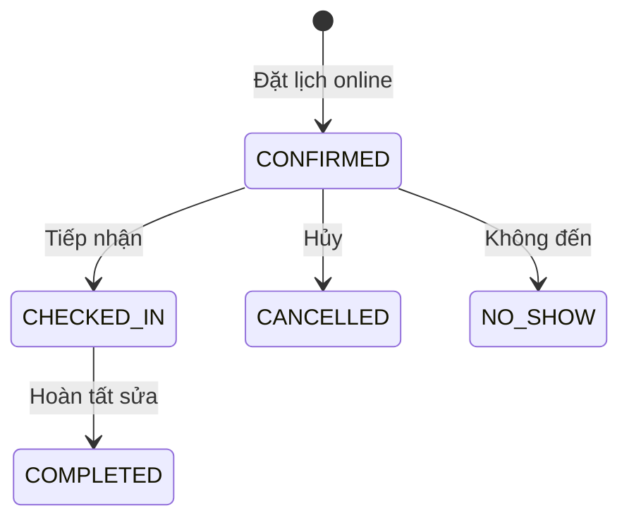

# Đặc tả Garage MVP

Trạng thái: identity MVP, lịch/danh mục dịch vụ và migration danh mục phụ tùng đã có trong source. Guest booking và tra cứu công khai đang được triển khai trên branch `codex/guest-booking-public-lookup`; xem [plan và handoff](plans/guest-booking-public-lookup.md). Chưa nghiệm thu tích hợp SQL Server và trình duyệt cho feature này. Ngày cập nhật: 18/11/2026.

Tài liệu liên quan: [ERD](erd.md), [kiến trúc](architecture.md).

## 1. Mục tiêu và giới hạn

Quản lý một garage ô tô và xe máy từ đặt lịch đến sửa xong, thu tiền và theo dõi phụ tùng. Khách đặt lịch không cần đăng nhập; chỉ Admin và Staff có tài khoản trong MVP.

Ba nguyên tắc bắt buộc:

1. `Customer` là hồ sơ nghiệp vụ, `User` là tài khoản đăng nhập; hai khái niệm độc lập.
2. Guest booking vẫn lưu khách hàng và xe trong database, với thông tin liên hệ tối thiểu.
3. Có thể thêm tài khoản khách hàng sau này mà không thay đổi quan hệ booking, xe và phiếu sửa.

| Trong MVP | Ngoài MVP |
|---|---|
| Đặt lịch theo slot, tra cứu công khai | Tài khoản khách, OTP, nhắc lịch SMS/Zalo |
| Tiếp nhận khách online và khách đến trực tiếp | Đa chi nhánh, đa kho, phân công từng thợ |
| Phiếu sửa, công việc và phụ tùng thực dùng | Tối ưu cầu nâng hoặc lịch theo thời lượng sửa |
| Nhập–xuất–tồn cơ bản | Nhà cung cấp, đơn mua, kế toán và giá vốn |
| Hóa đơn nội bộ, đánh dấu thu đủ | Hóa đơn điện tử, cổng thanh toán, trả góp, đặt cọc và công nợ |

## 2. Vai trò và phân quyền

Admin có toàn bộ quyền Staff. Không có đăng ký tài khoản công khai cho nhân viên.

| Chức năng | Guest | Staff | Admin |
|---|---|---|---|
| Xem dịch vụ, slot; tạo booking | Có | Có | Có |
| Tra cứu public theo SĐT hoặc mã | Có | Có | Có |
| Đọc đầy đủ khách hàng và xe | Không | Có | Có |
| Đổi/hủy lịch, tiếp nhận xe | Không | Có | Có |
| Lập phiếu sửa, ghi công việc, chốt sửa | Không | Có | Có |
| Xem phụ tùng/tồn; xuất dùng/hoàn vật tư của phiếu đang sửa | Không | Có | Có |
| Đọc hóa đơn và đánh dấu thu đủ | Không | Có | Có |
| Sửa nhầm trạng thái thanh toán, bắt buộc lý do | Không | Không | Có |
| Quản lý tài khoản, danh mục dịch vụ/phụ tùng | Không | Không | Có |
| Nhập kho, điều chỉnh tồn có lý do | Không | Không | Có |
| Cấu hình giờ làm, sức chứa, ngày nghỉ | Không | Không | Có |

Mọi quyền phải được kiểm tra tại backend. Khi khóa tài khoản, đổi role hoặc reset mật khẩu, tăng `users.auth_version`; session cũ mất quyền truy cập từ request nội bộ kế tiếp. Backend đọc lại trạng thái/version từ DB trước khi cấp quyền, không dựa mãi vào role đã lưu trong session. Không ngắt cưỡng bức request đã được cấp quyền trước khi thay đổi commit.

## 3. Đặt lịch và hồ sơ khách

### 3.1 Dữ liệu đầu vào

| Trường | Quy tắc |
|---|---|
| Họ tên liên hệ | Bắt buộc, trim, 2–100 ký tự; không hạn chế tên có dấu |
| Số điện thoại | Bắt buộc; MVP nhận số di động Việt Nam hợp lệ ở dạng `0…` hoặc `+84…` |
| Loại xe | Bắt buộc, `CAR` hoặc `MOTORBIKE` |
| Biển số | Bắt buộc, trim, tối đa 20 ký tự; chuẩn hóa chữ hoa, bỏ khoảng trắng, dấu chấm và dấu gạch ngang khi đối chiếu |
| Hãng, mẫu xe | Tùy chọn, mỗi trường tối đa 100 ký tự |
| Dịch vụ | Ít nhất một dịch vụ đang hoạt động, phù hợp loại xe; không chọn lặp |
| Slot | Bắt buộc với booking online; backend kiểm tra lại thời gian và chỗ trống |
| Mô tả tình trạng | Tùy chọn, tối đa 1.000 ký tự, xử lý như văn bản thuần |

Số điện thoại chuẩn hóa về dạng `+84…`. Không kiểm tra bằng OTP và không khẳng định người đặt là chủ số điện thoại hoặc chủ xe.

### 3.2 Luồng tạo booking

1. Kiểm tra dữ liệu và dịch vụ; client gửi `Idempotency-Key` cho lần gửi này.
2. Mở transaction, khóa idempotency key rồi slot theo loại xe; kiểm tra thời gian, booking trùng biển số chuẩn hóa và chỗ còn lại.
3. Tìm customer bằng số điện thoại chuẩn hóa; có thì dùng ID cũ, chưa có thì tạo. Unique constraint là lớp bảo vệ cuối cùng khi có request đồng thời.
4. Tìm xe theo `customer_id + plate_normalized`; dùng xe cũ hoặc tạo mới. Không dò và trả hồ sơ xe của khách khác cho guest.
5. Với xe cũ, loại xe phải khớp; sai thì trả lỗi để người đặt kiểm tra, không tự đổi loại xe. Không ghi đè tên, hãng hoặc mẫu xe của hồ sơ cũ bằng dữ liệu guest.
6. Tạo booking `CONFIRMED`, lưu snapshot thông tin người liên hệ/xe và danh sách dịch vụ với giá tham khảo tại thời điểm đặt.
7. Commit và trả mã đặt lịch, thời gian, trạng thái và dịch vụ. Khách lưu mã trên màn hình; MVP chưa gửi tin nhắn.

Booking thất bại không để lại customer/xe mới hoặc giữ chỗ dở dang. Retry cùng khóa và cùng nội dung trả lại kết quả cũ; cùng khóa nhưng khác nội dung trả `409`.

Khác idempotency key vẫn không được tạo hai booking cho cùng biển số chuẩn hóa trong cùng `slot_id` nếu booking trước đang `CONFIRMED`, `CHECKED_IN` hoặc `COMPLETED`. Kiểm tra theo snapshot biển số chuẩn hóa, kể cả người đặt dùng số điện thoại khác; chỉ `CANCELLED`, `NO_SHOW` giải phóng quyền đặt lại. Trả `409 BOOKING_CONFLICT` với thông báo chung, không tiết lộ hồ sơ hoặc mã lịch trước. Quy tắc này giới hạn theo cùng slot tiếp nhận, chưa giải quyết mọi lịch chồng lấn theo thời gian sửa.

Số điện thoại là khóa gom hồ sơ trong MVP. Người dùng chung một số sẽ được gom vào cùng khách; không tự gộp hồ sơ khác số. Staff đổi SĐT phải kiểm tra unique, không được tự nhập chung lịch sử hai khách.

### 3.3 Quy tắc slot

- Mặc định làm việc Thứ 2–Thứ 7; 08:00–12:00 và 13:00–17:00; nghỉ Chủ nhật.
- Slot 60 phút, bắt đầu theo từng khoảng làm việc. Slot cuối buổi sáng là 11:00–12:00, buổi chiều là 16:00–17:00.
- Sức chứa mỗi giờ: 1 ô tô và 2 xe máy, quản lý tách riêng.
- Giờ bắt đầu phải cách hiện tại ít nhất 60 phút, và ngày hẹn không quá 14 ngày tính theo ngày tại garage.
- Một booking chiếm một chỗ, không phụ thuộc số dịch vụ. Slot là giờ tiếp nhận, không phải giờ hoàn tất.
- Booking `CONFIRMED`, `CHECKED_IN`, `COMPLETED` vẫn được tính trong số lượt đã nhận của slot; chỉ `CANCELLED`, `NO_SHOW` không chiếm chỗ.
- Staff đổi lịch chỉ khi booking còn `CONFIRMED`; phải thỏa các quy tắc giờ, ngày và sức chứa như booking mới. MVP không có quyền vượt sức chứa.
- `NO_SHOW` chỉ được ghi nhận sau khi giờ kết thúc slot đã qua; không tự động đánh dấu không đến.
- Admin được khóa slot chưa đến giờ để ngừng nhận thêm. Lịch đang có được giữ nguyên; giảm capacity dưới số chỗ đã dùng bị từ chối.
- Thay đổi mẫu giờ làm chỉ tái tạo slot tương lai chưa có lịch; slot đã có lịch giữ nguyên, muốn chuyển phải do Staff thực hiện.
- Sinh sẵn slot khi khởi động, mỗi ngày lúc 00:05 theo giờ garage và sau khi Admin sửa cấu hình. API đọc slot không sinh hoặc sửa dữ liệu; nếu ngày yêu cầu chưa được sinh do lỗi vận hành thì trả `503 SLOT_SCHEDULE_UNAVAILABLE`, không báo nhầm là hết chỗ.

### 3.4 Khách đến trực tiếp

Staff tạo booking `WALK_IN` với thông tin khách/xe/dịch vụ và tiếp nhận trong cùng thao tác. `slot_id` để trống; thời điểm tiếp nhận là thời điểm thực tế. Không trừ sức chứa lịch online; Staff tự cân nhắc khả năng tiếp nhận trước khi nhập.

## 4. Tiếp nhận và sửa chữa

### 4.1 Trạng thái

Khách đến trực tiếp được tạo thẳng ở trạng thái `CHECKED_IN`. Một booking có tối đa một phiếu sửa; tiếp nhận lặp không tạo phiếu thứ hai.

Phiếu sửa có hai trạng thái `IN_PROGRESS → COMPLETED`. Khi check-in online hoặc tạo walk-in, tạo thẳng phiếu `IN_PROGRESS`; Staff có thể ghi công việc, xuất/hoàn phụ tùng ngay. Không có trạng thái `OPEN` hoặc nút bắt đầu sửa riêng trong MVP.

Sau tiếp nhận không dùng thao tác hủy booking. Nếu khách dừng sửa, Staff hoàn vật tư chưa dùng và hoàn tất với các công việc thực tế, có thể tổng tiền bằng 0; chưa hỗ trợ quy trình tranh chấp/hoàn tiền.

### 4.2 Nội dung phiếu sửa

- Ghi nhận tình trạng xe, số km nếu có, công việc thực hiện và ghi chú nội bộ riêng.
- Dòng `LABOR`: tên công việc, số lượng và đơn giá; có thể liên kết dịch vụ danh mục hoặc là công việc phát sinh.
- Dòng `LABOR` bị loại khỏi phiếu đang sửa được đánh dấu `voided_at` và `voided_by`, không hard-delete. Chỉ dòng LABOR chưa void mới được hiển thị/tính phí. Không void dòng PART hoặc dòng đã có biến động kho.
- Dòng `PART`: mỗi phiếu có tối đa một dòng cho mỗi `part_id`; mọi lần xuất/hoàn cùng phụ tùng trên phiếu trỏ vào dòng này. Số lượng bằng tổng xuất trừ tổng hoàn.
- Lần xuất đầu tạo dòng PART và chụp đơn giá bán; xuất thêm giữ nguyên đơn giá của dòng, kể cả danh mục đã đổi giá. Nếu Staff đổi giá qua thao tác riêng trước hoàn tất, giá mới áp dụng cho toàn bộ số lượng ròng trên dòng, bắt buộc lý do và audit. MVP không tách nhiều giá theo từng lần xuất.
- Được bổ sung công việc khác dịch vụ đã đặt. Dịch vụ yêu cầu ban đầu vẫn giữ trong booking để đối chiếu.
- Tổng thực tế bằng tổng `số lượng × đơn giá` của các dòng đang tính phí; từng dòng dùng `BigDecimal.setScale(0, RoundingMode.HALF_UP)` rồi mới cộng. Ví dụ `0.500 × 101 = 50.5` thành 51 VND; không dùng số thực nhị phân để tính tiền. Giá không âm, số lượng công việc lớn hơn 0.
- Staff có thể sửa tên công việc và giá trước hoàn tất. Số lượng phụ tùng đã xuất chỉ thay đổi qua thao tác xuất/hoàn, không sửa trực tiếp.
- Chỉ hoàn tất khi phiếu ở `IN_PROGRESS`, các thao tác kho đã thành công và dữ liệu hợp lệ. Chốt phiếu, hoàn tất booking và tạo hóa đơn trong cùng transaction.
- Phiếu hoàn tất không chỉnh sửa hoặc mở lại trong MVP. Không cập nhật đơn giá lịch sử khi đổi giá danh mục.

## 5. Kho phụ tùng

- Một danh mục phụ tùng dùng chung một kho. Mỗi phụ tùng có mã unique, tên, đơn vị tính, loại xe áp dụng, giá bán tham khảo, tồn hiện tại và trạng thái hoạt động.
- Hỗ trợ đơn vị có phần lẻ, ví dụ lít dầu; số lượng tối đa ba chữ số thập phân. Không đổi đơn vị sau khi có biến động kho.
- `RECEIPT`: Admin nhập số lượng dương, lý do bắt buộc sau trim dài 1–500 ký tự và ghi chú tùy chọn tối đa 500 ký tự; ghi chú trống lưu thành `NULL`. Không tạo đơn mua hoặc công nợ nhà cung cấp.
- `ISSUE`: Staff xác nhận dùng trên phiếu đang `IN_PROGRESS`; trừ kho, tạo/cập nhật dòng phụ tùng và ghi ledger trong một transaction. Lý do ledger được hệ thống ghi mặc định.
- `RETURN`: Staff hoàn một phần hoặc toàn bộ lượng đã xuất trên phiếu còn `IN_PROGRESS`; liên kết giao dịch xuất gốc, tăng kho và giảm lượng tính phí. Lý do ledger được hệ thống ghi mặc định. Hoàn hết vẫn giữ dòng PART và đơn giá; xuất lại trên cùng phiếu dùng lại dòng đó.
- `ADJUSTMENT`: Admin ghi chênh lệch khác 0, tăng hoặc giảm, có lý do bắt buộc sau trim dài 1–500 ký tự. Không dùng điều chỉnh để giả lập hoàn phụ tùng của phiếu sửa.
- Từ chối xuất thiếu tồn, phụ tùng ngừng hoạt động hoặc không phù hợp loại xe; từ chối hoàn quá lượng xuất chưa hoàn.
- Ledger chỉ thêm mới, không sửa/xóa. Lịch sử thể hiện người thao tác, thời gian, số lượng trước/sau và phiếu liên quan.
- Phụ tùng ngừng hoạt động vẫn có thể được hoàn kho nếu trước đó đã xuất hợp lệ.

## 6. Hóa đơn và thanh toán

Hóa đơn trong MVP là chứng từ nội bộ, không phải hóa đơn điện tử. Một phiếu hoàn tất sinh đúng một hóa đơn, mã riêng, lưu tổng tiền cố định; chi tiết lấy từ các dòng phiếu sửa đã khóa.

- Hóa đơn mới ở trạng thái `UNPAID`. Staff và Admin được xác nhận thu đủ để chuyển sang `PAID`. Sau khi Admin sửa ghi nhận về `UNPAID`, có thể ghi nhận thu lại.
- Với tổng tiền lớn hơn 0, ghi số tiền bằng tổng hóa đơn, phương thức `CASH` hoặc `BANK_TRANSFER`, người thu và thời gian thu.
- Tổng tiền bằng 0 được đánh dấu `PAID` với phương thức `NO_CHARGE` và số tiền thu bằng 0.
- Không tạo giao dịch ngân hàng hoặc tự xác minh chuyển khoản; nhân viên xác nhận thủ công.
- Admin được sửa ghi nhận từ `PAID` về `UNPAID`, với lý do dài 1–500 ký tự sau khi bỏ khoảng trắng đầu/cuối. Thao tác xóa thông tin thu hiện tại khỏi hóa đơn. Cả thu đủ và sửa ghi nhận đều lưu audit trước/sau cùng người thực hiện. Thao tác sửa chỉ cập nhật hồ sơ nội bộ.
- Mục Hóa đơn của Staff/Admin có lọc trạng thái và phân trang. Chi tiết hiển thị các dòng đã chốt, tổng tiền và thông tin thu. Phiếu hoàn tất và hóa đơn có liên kết qua lại. UI yêu cầu xác nhận số tiền và phương thức, với nút xác nhận miễn phí riêng cho tổng 0. Chỉ Admin thấy biểu mẫu sửa ghi nhận khi hóa đơn đã thanh toán.
- Hợp đồng bàn giao tra cứu công khai chỉ bổ sung `totalAmount` và `paymentStatus` khi booking có hóa đơn. Guest Booking tích hợp hai trường này qua projection chỉ đọc.
- Chưa có đặt cọc, trả nhiều lần, giảm giá, thuế tách riêng hay hoàn tiền.

## 7. Tra cứu công khai

Khách nhập đúng một trong hai: số điện thoại hoặc mã booking. Tra mã hóa đơn riêng chưa nằm trong luồng tra cứu public; UI gọi rõ trường là “Mã đặt lịch”.

- SĐT được chuẩn hóa và so khớp chính xác, trả tất cả booking của customer đó theo thời gian mới nhất, có phân trang.
- Mã booking so khớp chính xác và chỉ trả một booking, không trả các lịch khác của cùng khách.
- Không có đăng nhập, OTP hoặc mã bí mật; không cấp quyền đổi/hủy lịch từ kết quả tra cứu.
- Không có kết quả thì trả danh sách rỗng; không xác nhận riêng số điện thoại đã có trong hồ sơ hay chưa.

| Được trả public | Không được trả public |
|---|---|
| Mã booking, thời gian, loại xe, biển số che bớt | Họ tên, SĐT đầy đủ, địa chỉ, customer/vehicle ID |
| Dịch vụ, trạng thái booking và phiếu sửa | Ghi chú nội bộ và thông tin nhân viên |
| Nội dung công việc đã thực hiện, phụ tùng thực dùng | Ledger kho, lý do điều chỉnh và audit |
| Tiền tạm tính/đã chốt, trạng thái thanh toán | Session, thông tin đăng nhập, dữ liệu quản trị |

Biển số public chỉ giữ ba ký tự cuối, phần còn lại thay bằng `*`. Tên hiển thị công việc phải tách khỏi ghi chú nội bộ, không đưa thông tin liên hệ vào tên công việc.

Tra cứu được thiết kế công khai theo yêu cầu sản phẩm: người biết số điện thoại vẫn có thể xem các đơn và chi phí liên quan. Che liên hệ và giới hạn tần suất không biến luồng này thành xác thực danh tính.

## 8. Yêu cầu kỹ thuật và vận hành

- Java 21, Spring Boot, Maven; SQL Server 2022+; Flyway T-SQL; React + TypeScript + Vite.
- Một backend, một database; chưa có Redis, queue hoặc microservices.
- Session cookie cho Admin/Staff, hash mật khẩu, CSRF protection, HTTPS khi deploy và phân quyền backend.
- API public có validation, rate limit; không log số điện thoại, biển số, body tra cứu, mật khẩu hoặc cookie.
- Giờ API dùng ISO 8601 có offset; quyết định ngày/giờ hoạt động theo `Asia/Ho_Chi_Minh`.
- Danh sách quản trị và lịch sử có phân trang; mặc định 20 bản ghi, tối đa 100.
- Dữ liệu lịch sử không hard-delete. Dùng vô hiệu hóa cho user/danh mục; không xóa customer/xe đang có booking.
- Backup SQL Server hàng ngày; thử khôi phục trên database riêng trước sử dụng thực tế. Mục tiêu MVP: mất tối đa dữ liệu từ lần backup gần nhất, chưa có cơ chế high availability.
- Tiêu chí tải demo: 20 người dùng đồng thời, API đọc có p95 dưới 2 giây trên môi trường đo được ghi nhận; ưu tiên transaction đúng hơn tối ưu phân tán.

## 9. Tiêu chí nghiệm thu

| Mã | Kịch bản đạt |
|---|---|
| AC-01 | Guest đặt thành công, có mã, customer và xe trong DB dù không có user |
| AC-02 | SĐT dạng `0…` và `+84…` cùng một hồ sơ; xe không bị tạo lặp trong cùng khách |
| AC-03 | Hai request cùng SĐT tạo đồng thời vẫn chỉ có một customer |
| AC-04 | Nhiều request tranh chỗ cuối không vượt capacity; hết chỗ trả `409` |
| AC-05 | Retry booking cùng khóa không tạo thêm lịch; lỗi rollback cả customer/xe vừa tạo |
| AC-06 | Chặn giờ ngoài lịch làm, ngày nghỉ, thiếu lead time và quá 14 ngày |
| AC-07 | Đổi/hủy/không đến cập nhật đúng chỗ; đổi thất bại giữ nguyên lịch cũ |
| AC-08 | Tiếp nhận online/walk-in chỉ tạo một phiếu; guest không sửa được booking |
| AC-09 | Công việc phát sinh không thay đổi danh sách dịch vụ đã yêu cầu |
| AC-10 | Xuất/hoàn kho đồng thời không âm tồn hoặc hoàn quá; retry không ghi ledger lặp |
| AC-11 | Hoàn phụ tùng giảm số lượng tính phí; phần đã dùng giữ giá snapshot |
| AC-12 | Hoàn tất tạo đúng một hóa đơn; thay giá danh mục không đổi tổng tiền đã chốt |
| AC-13 | Thu đủ ghi đúng người/phương thức/thời điểm; Staff không sửa nhầm thanh toán |
| AC-14 | Tra SĐT trả các đơn liên quan; tra mã chỉ trả đúng một đơn; không lộ trường bị ẩn |
| AC-15 | Guest không truy cập API nội bộ; Staff bị chặn chức năng Admin |
| AC-16 | Migration chạy trên SQL Server sạch; chạy lại không lặp schema; backup có thể khôi phục |
| AC-17 | Cùng biển số/slot với key hoặc SĐT khác vẫn bị chặn; lịch đã hủy/không đến cho phép đặt lại; lịch hoàn tất không giải phóng lượt |
| AC-18 | Xuất cùng part nhiều lần chỉ có một dòng PART; đổi giá áp dụng toàn dòng, có lý do/audit; hoàn hết rồi xuất lại giữ đúng dòng |
| AC-19 | Check-in online/walk-in tạo thẳng IN_PROGRESS; không cần thao tác start và không sửa phiếu COMPLETED |
| AC-20 | Nhiều request cùng idempotency key chờ và nhận một kết quả; nếu request đầu rollback thì request sau được xử lý mới |
| AC-21 | Hai session cũ đều bị từ chối từ request kế tiếp sau khóa/đổi role/reset mật khẩu; mở khóa không làm session cũ sống lại |
| AC-22 | GET slot không INSERT/UPDATE; startup, lịch chạy mỗi ngày và đổi cấu hình sinh đúng slot, không trùng/chồng lấn |
| AC-23 | Giá trị .5 VND làm tròn HALF_UP theo từng dòng; tổng hóa đơn khớp giữa Java và SQL DECIMAL |
| AC-24 | Check-in lặp đồng thời hoàn tất sửa không khóa ngược booking/phiếu; không tạo phiếu mới hoặc chuyển lùi trạng thái |

## 10. Thứ tự triển khai tiếp

1. Migration nền, identity, customer và catalog.
2. Slot, booking, tra cứu và trang đặt lịch.
3. Tiếp nhận, phiếu sửa và nghiệp vụ xuất/hoàn kho.
4. Hóa đơn, thanh toán, màn hình quản trị kho và cấu hình.
5. Kiểm thử SQL Server, E2E, backup/restore và deploy cùng domain.

Customer Authentication triển khai sau bằng bảng tài khoản khách liên kết `customers.id`; phải xác minh quyền sử dụng số điện thoại trước liên kết lịch sử. Việc có tài khoản khách sau này không tự thay đổi chính sách tra cứu public đã chốt cho MVP.
